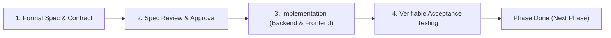
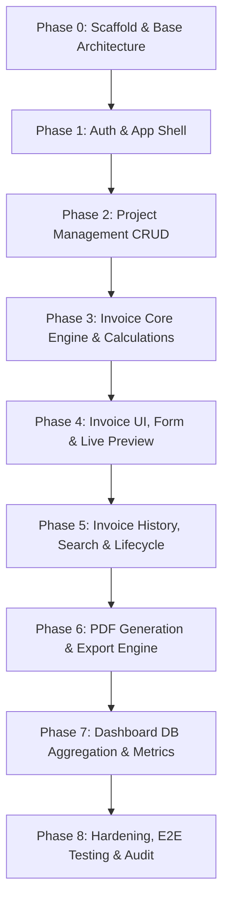

# Spec-Driven Development Plan: MERN Invoice Generator

This plan establishes a **Spec-Driven Development (SDD)** process for building the company service invoice generator. Every feature is specified in full (data schema, API contract, business logic, UX states, and acceptance criteria) before code is written, ensuring strict compliance with [GEMINI.md](file:///c:/Users/Abhin/OneDrive/Desktop/inovice%20generator%201/GEMINI.md) and [mern-invoice-generator-plan.md](file:///c:/Users/Abhin/OneDrive/Desktop/inovice%20generator%201/mern-invoice-generator-plan.md).

---

## 1. Spec-Driven Development Lifecycle

Every phase strictly follows this 4-step loop:



1. **Formal Spec**: Define Mongoose schema, validation rules (Zod/express-validator), exact REST endpoint shapes, business calculations, and UI states (loading, empty, error, success).
2. **Review & Freeze**: Ensure data integrity, immutability rules, and accounting invariants are satisfied before writing implementation code.
3. **Focused Implementation**: Build backend services, controllers, and routes first, then build client-side components and API clients.
4. **Verification**: Run automated tests, check error boundaries, and verify the feature meets the *Definition of Done*.

---

## 2. Core Architectural Invariants (Non-Negotiables)

1. **Financial Authority**: Total calculations (`subtotal`, `taxAmount`, `totalAmount`) are calculated and rounded authoritatively on the backend. Client values are untrusted.
2. **Safe Numbering**: Invoice numbers are generated using an atomic, concurrency-safe sequence counter in MongoDB, not by counting existing documents.
3. **Historical Snapshots**: Company and client details are frozen inside the invoice document at issuance time to ensure historic invoices remain immutable.
4. **State Machine Integrity**: Issued and paid invoices cannot be silently updated or deleted. Only permitted status transitions (`draft` → `issued` → `paid` / `cancelled`) are allowed.
5. **No Mock Data**: Real API contracts with proper validation, status codes, and error middleware.

---

## 3. Phase-by-Phase Spec-Driven Implementation Plan



---

### Phase 0: Project Scaffold & Base Environment

#### Goal
Initialize separate `Frontend` and `Backend` projects with standardized toolchains, directory layouts, environment configurations, and core middleware.

#### Deliverables & Specs
* **Backend (`/Backend`)**:
  * Node.js + Express initialization with ES Modules.
  * Centralized MongoDB connection (`src/config/db.js`).
  * Global error middleware (`src/middleware/errorMiddleware.js`) and unified API response envelope helper:
    ```json
    { "success": true, "message": "...", "data": {} }
    ```
  * Request logging, CORS configuration, and security headers (`helmet`).
* **Frontend (`/Frontend`)**:
  * Vite + React + Tailwind CSS / standard CSS setup.
  * Centralized Axios client (`src/api/axios.js`) with request/response interceptors.
  * Shared base components (`Button`, `Input`, `Loader`, `Modal`, `DataTable`).
* **Verification**:
  * Health check endpoint `GET /api/health` returns status `200`.
  * Frontend boots and consumes the health endpoint cleanly.

---

### Phase 1: Authentication & App Shell (Priority 1)

#### Goal
Secure authentication system, protected routes, session persistence, and responsive application layout.

#### Specifications
1. **User Schema (`src/models/User.js`)**:
   * Fields: `name` (String, required), `email` (String, unique, lowercase, trimmed), `password` (String, hashed with bcrypt), `isActive` (Boolean, default: true).
   * Invariant: Password is never returned in API payloads (`select: false` or controller projection).
2. **API Contract**:
   * `POST /api/auth/login`: Accepts `{ email, password }`. Validates format, matches hash, returns HTTP-only cookie or signed JWT + sanitized user profile.
   * `POST /api/auth/logout`: Clears session / auth token cookie.
   * `GET /api/auth/me`: Returns currently authenticated user context.
3. **Frontend Shell**:
   * `AuthContext` + `useAuth` hook.
   * `ProtectedRoute` wrapper guarding private views.
   * Responsive `AppLayout` with collapsible `Sidebar`, `Topbar` with user profile, and sign-out trigger.
4. **Acceptance Criteria**:
   * Unauthenticated requests to protected endpoints return `401 Unauthorized`.
   * Invalid credentials return uniform client-safe error messages.
   * Session persists across page reloads and terminates properly on logout.

---

### Phase 2: Project Management CRUD (Priority 2)

#### Goal
Manage company projects and client metadata that invoices will link to.

#### Specifications
1. **Project Schema (`src/models/Project.js`)**:
   * Fields: `projectCode` (String, unique, indexed), `name` (String, required), `clientName` (String, required), `clientEmail` (String, required), `clientAddress` (String), `serviceType` (String), `startDate` (Date), `endDate` (Date), `status` (Enum: `planned`, `active`, `completed`, `on_hold`, `archived`), `createdBy` (ObjectId, ref: User).
2. **API Contract**:
   * `POST /api/projects`: Validates payload schema with validator middleware. Creates project.
   * `GET /api/projects`: Paginated list (`page`, `limit`, `search`, `status`). Returns `{ data: [...], pagination: { total, page, pages } }`.
   * `GET /api/projects/:id`: Fetches single project detail.
   * `PATCH /api/projects/:id`: Updates editable metadata.
   * `DELETE /api/projects/:id`: Validates that no issued invoices exist for this project. If invoices exist, blocks deletion and requires archiving.
3. **Frontend UI**:
   * Projects list with search bar, status badges, pagination, and empty state.
   * Create/Edit Project modal with field-level validation and submission spinners.
4. **Acceptance Criteria**:
   * Unique `projectCode` is enforced with proper MongoDB conflict handling (`409 Conflict`).
   * Permanent deletion is blocked if dependencies exist.

---

### Phase 3: Invoice Core Engine & Calculations (Priority 3)

#### Goal
The financial backbone: concurrency-safe numbering, authoritative calculation engine, and invoice persistence.

#### Specifications
1. **Invoice Number Generator (`src/utils/generateInvoiceNumber.js`)**:
   * Concurrency-safe counter collection (`counters`) using `findOneAndUpdate({ _id: 'invoiceNumber' }, { $inc: { seq: 1 } }, { upsert: true, new: true })`.
   * Formatted as `INV-YYYY-XXXX` (e.g., `INV-2026-0001`).
2. **Financial Calculation Engine (`src/utils/calculateInvoiceTotals.js`)**:
   * Input: `items: [{ description, quantity, unitPrice }]`, `discountRate` / `discountAmount`, `taxRate`.
   * Rules:
     * Line amount: $\text{quantity} \times \text{unitPrice}$ (rounded to 2 decimal places).
     * Subtotal: $\sum \text{line amounts}$.
     * Taxable amount: $\max(0, \text{subtotal} - \text{discount})$.
     * Tax amount: $\text{taxable amount} \times \frac{\text{taxRate}}{100}$ (rounded to 2 decimal places).
     * Total amount: $\text{taxable amount} + \text{taxAmount}$.
   * Never trust client totals; backend recalculates every item.
3. **Invoice Schema (`src/models/Invoice.js`)**:
   * `invoiceNumber` (String, unique, indexed).
   * `project` (ObjectId, ref: Project, indexed).
   * `clientSnapshot` (Frozen name, email, address, taxId).
   * `companySnapshot` (Frozen company name, address, taxId, bank info).
   * `items` (`description`, `quantity`, `unitPrice`, `amount`).
   * `subtotal`, `discount`, `taxRate`, `taxAmount`, `totalAmount`, `currency`.
   * `status` (Enum: `draft`, `issued`, `paid`, `overdue`, `cancelled`).
   * `issueDate`, `dueDate`, `createdBy`.
4. **State Machine & Mutation Guards**:
   * `draft`: Can be edited, deleted, or transitioned to `issued`.
   * `issued`: Cannot be edited or deleted. Can be marked `paid` or `cancelled`.
   * `paid`: Terminal financial record. Cannot be deleted or edited.
5. **Acceptance Criteria**:
   * Concurrent invoice creations never produce duplicate invoice numbers.
   * Decimal rounding errors ($0.01$ discrepancies) are eliminated.
   * Direct updates to `issued` or `paid` invoices are rejected with `403 Forbidden`.

---

### Phase 4: Invoice UI, Interactive Form & Live Preview (Priority 4)

#### Goal
A seamless, accurate invoice creation workflow with real-time preview and unsaved changes warning.

#### Specifications
1. **Form Capabilities (`InvoiceForm.jsx`)**:
   * Project selector: Auto-populates client snapshot data.
   * Dynamic line items table: Add/remove row, positive number inputs, description.
   * Client-side preview calculations matching backend calculation rules exactly.
   * Action buttons: "Save as Draft", "Issue Invoice".
2. **Live Invoice Preview (`InvoicePreview.jsx`)**:
   * Branded layout reflecting real-world paper invoice design.
   * Company logo, header details, itemized table, subtotal, tax breakdown, and terms.
3. **UX Protections**:
   * Confirmation prompt when navigating away with dirty form state.
   * Form submission button disabled during in-flight requests.
4. **Acceptance Criteria**:
   * Preview matches final saved invoice data $100\%$.
   * Validation errors display inline next to faulty line items.

---

### Phase 5: Invoice History, Search, Filters & Lifecycle (Priority 5)

#### Goal
Comprehensive dashboard history table with filtering, search, pagination, and status actions.

#### Specifications
1. **API Endpoints**:
   * `GET /api/invoices`: Query params `page`, `limit`, `search` (number or client), `status`, `startDate`, `endDate`.
   * `PATCH /api/invoices/:id/status`: Transition invoice status according to state machine rules.
2. **History UI (`InvoiceHistory.jsx`)**:
   * Filter controls (status dropdown, date pickers, search input).
   * Status indicators (`draft` = gray, `issued` = blue, `paid` = green, `overdue` = amber, `cancelled` = red).
   * Row actions: View Details, Download PDF, Change Status, Delete (only enabled if status is `draft`).
3. **Acceptance Criteria**:
   * Fast queries backed by compound indexes (`{ status: 1, issueDate: -1 }`).
   * No UI action allows deleting an `issued` or `paid` invoice.

---

### Phase 6: PDF Generation & Export Engine (Priority 6)

#### Goal
Pixel-perfect, print-ready PDF invoices downloadable from the API or client.

#### Specifications
1. **Engine**:
   * Backend PDF streaming using `PDFKit` or reliable HTML-to-PDF rendering.
   * Document properties: title, metadata, company header, invoice ID, table formatting, payment details.
2. **API Endpoint**:
   * `GET /api/invoices/:id/pdf`: Streams `application/pdf` with header `Content-Disposition: attachment; filename="INV-XXXX.pdf"`.
3. **Frontend Integration**:
   * "Download PDF" button with loading state.
   * Direct print preview option (`window.print` styled layout).
4. **Acceptance Criteria**:
   * PDF numbers, dates, and currency totals match the database record down to the cent.
   * PDF renders multi-page invoices cleanly without clipping line items.

---

### Phase 7: Dashboard Metrics & Database Aggregation (Priority 7)

#### Goal
Accurate business intelligence dashboard driven entirely by real-time MongoDB aggregations.

#### Specifications
1. **Aggregation Pipeline (`dashboardService.js`)**:
   * Use `$facet` pipeline for a single-query round-trip calculating:
     * `totalProjects`: Count of non-archived projects.
     * `totalInvoices`: Count of all active invoices (excluding drafts if desired).
     * `totalInvoiced`: Sum of `totalAmount` for all `issued` and `paid` invoices.
     * `outstandingBalance`: Sum of `totalAmount` for `issued` (unpaid) invoices.
     * `statusBreakdown`: Group by status with count and sum.
     * `recentInvoices`: Latest 5 invoices sorted by `createdAt: -1`.
2. **API Contract**:
   * `GET /api/dashboard/summary`
3. **Frontend Dashboard UI**:
   * Metric cards with clean typographic hierarchy.
   * Recent activity table with direct link to invoice details.
   * Quick action buttons: "New Invoice", "New Project".
4. **Acceptance Criteria**:
   * Metrics react immediately to newly issued invoices and status changes.
   * Zero hardcoded or mock metric values.

---

### Phase 8: Hardening, E2E Testing & Audit (Priority 8)

#### Goal
Production hardening, security audits, automated testing, and backup protocols.

#### Specifications
1. **Security & Rate Limiting**:
   * Add `express-rate-limit` to `/api/auth/login` to prevent brute force.
   * Enforce MongoDB ObjectId validation middleware on all parameterized routes (`/api/*/:id`).
   * Ensure no stack traces or database connection URIs leak in error responses.
2. **Automated Testing Suite**:
   * Unit tests for `calculateInvoiceTotals` and `generateInvoiceNumber`.
   * Integration tests with `supertest` covering auth flow, project CRUD, and invoice state transitions.
3. **Environment & Backup**:
   * Complete `.env.example` verified for both Frontend and Backend.
   * Backup script guidelines documented for MongoDB Atlas / CLI.

---

## 4. Verification & Definition of Done Matrix

| Phase | Core Deliverable | Target Validation Check |
|---|---|---|
| **Phase 0** | Scaffold & Config | Both services run; `/api/health` returns `200 OK`. |
| **Phase 1** | Auth & App Shell | Login with bcrypt, route protection, token lifecycle. |
| **Phase 2** | Project CRUD | Full CRUD tested; duplicate projectCode rejected; active invoice deletion safeguard verified. |
| **Phase 3** | Invoice Engine | Concurrency test on sequential numbering; math test on rounding; status transition validator. |
| **Phase 4** | Invoice Form & Preview | Live client preview matches backend calculation to the penny; draft save succeeds. |
| **Phase 5** | History & Search | Filtering by status/date; pagination check; delete restriction on issued invoices. |
| **Phase 6** | PDF Export | Streamed PDF downloads cleanly; layout verified across single and multi-page items. |
| **Phase 7** | Dashboard Metrics | Real DB aggregation verified against database fixtures. |
| **Phase 8** | Hardening & E2E | All automated tests pass; rate limiting verified; zero sensitive logs. |

---

## 5. Immediate Next Step

To begin execution of this plan, we start with **Phase 0 (Scaffold & Base Architecture)**:
1. Initialize the Express backend structure with standard scripts, dependencies, `.env.example`, and MongoDB connection logic.
2. Initialize the Vite + React frontend structure with Tailwind/CSS, Axios setup, and routing foundation.
3. Verify inter-service communication via `/api/health`.

